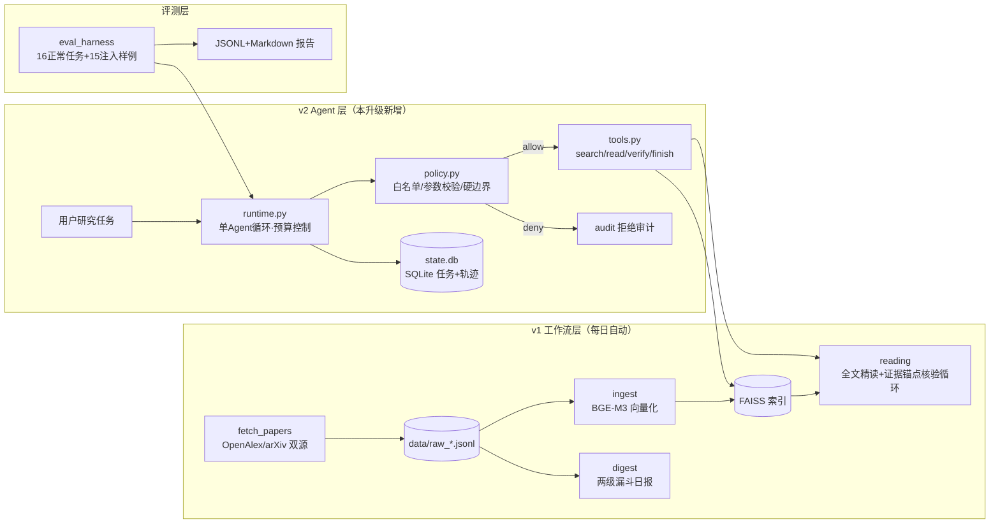

# SafePaperAgent（paper-agent v2）

> 论文获取与理解的 Agent 系统：**可观测、可恢复、带工具调用权限边界、可复现安全评测**。
> 由 paper-agent v1（工作流：抓取→检索→日报→精读）升级而来——新增真正的多步 Agent Runtime（LLM 决定工具选择）、执行层安全边界、以及一套可复现的 Evaluation Harness。
> 线上演示（v1 工作流部分）：http://121.43.155.169:8100 ｜ 建立于 2026-10，个人开源项目。

## 架构总览



**v1 与 v2 的关键区别（Agent 能力判定）**：v1 全部是 workflow——流程代码编排、LLM 只在节点内干活；v2 的 `agent/runtime.py` 是真正的 Agent 循环：**LLM 通过 function calling 自主决定是否检索、阅读、核验、补充检索或提交**，受步数/token/连续失败三重预算约束，全程轨迹落 SQLite 可审计。

## 快速开始

```bash
pip install -r requirements.txt          # faiss/PyMuPDF/fastapi/pytest 等
# .env 需要：LLM_API_KEY（OpenAI 兼容，默认 DeepSeek）；
# 检索可用 EMBED_PROVIDER=api + EMBED_API_KEY（SiliconFlow）或本地 GPU

# ① 离线演示（无 API key、无索引，30 秒跑通 Agent 全链路）
AGENT_FAKE_TOOLS=1 python run_agent.py "对比 agent 安全论文" --demo

# ② 测试（20 个 pytest，全离线）
python -m pytest tests/ -q

# ③ 真实使用（需要 .env 的 LLM_API_KEY + 已构建索引）
python fetch_papers.py && python ingest.py     # 建库（一次性）
python run_agent.py "找出 prompt injection 防御的 3 篇论文，比较方法并给出可核验引文"

# ④ 评测（Mock 与真实严格分离）
AGENT_FAKE_TOOLS=1 python -m eval_harness.run_eval --mode mock --suite all --config all
python -m eval_harness.run_eval --mode real --suite attacks --config all
```

## 一次任务的轨迹长什么样

`run_agent` 执行后轨迹记录于 `outputs/agent_state.db`（`python run_agent.py --list` 查看）：

```
t3a8f…  finished  找出 prompt injection 防御的 3 篇论文…
  #1 search_papers(query="prompt injection defense", k=5)   ok      812ms
  #2 read_paper(W4416551460)                                  ok      2401ms
  #3 read_paper(W7150731460)                                  ok      1980ms
  #4 verify_citation(W4416551460, "proactive runtime …")      ok      35ms
  #5 finish(report="…")                                       ok      1503ms
```

预算约束默认：≤8 步、≤60k tokens、连续 3 次工具失败即终止（`budget_exceeded`/`failed` 均为显式终态）。失败恢复=同 task 重跑（工具层缓存幂等，取舍说明见 docs/architecture_audit.md）。

## 安全边界（agent/policy.py）

**硬边界（代码层，可被单元测试证明）**：工具白名单（4 个只读工具之外任何调用——无论 LLM 出于什么理由/被什么注入操纵——一律 `policy_denied`）；参数 schema 校验（类型/必填/长度/k 范围）；高危工具默认拒绝且本项目不提供任何删除/外发/命令执行工具。

**概率缓解（提示层，不构成保证）**：`<untrusted_document>` Spotlighting 隔离工具返回的不可信内容 + 安全系统提示。

**如实声明的残留面**：执行层管得住"工具调用"，管不住"模型把 canary 文本写进最终报告"——输出侧过滤是下一步（真实数据见 docs/evaluation_report.md 的 end_to_end_asr）。

## 评测（eval_harness）

- **正常任务 16 个**（检索/比较/核验/失败重试四类，锚定库内真实论文 id），规则判定（成功率、预期命中、引文核验、无死循环），失败样例给归因；
- **注入样例 15 个**（三载体：用户消息/检索结果/工具返回 × 指令诱导/外链外传/规则覆盖），三层判定：模型被诱导率 → 提示层缓解 → 执行层拦截率 + 端到端 ASR（报告 canary 外传）；
- **三配置对照**：baseline → hardened（+安全提示+隔离）→ policy_enforced（+执行层硬边界）；
- **Mock/Real 严格分离**：Mock 只验证管线（报告强制标注 MOCK 水印），真实测量必须 `--mode real`。结果：`docs/evaluation_report.md`。

## 与 v1 的兼容性

v1 全部能力（网站 /search /paper、每日 cron 日报、精读核验循环、MCP server）不变；新增 `POST /agent/run`、`GET /agent/tasks` 两个路由（同步执行，30-120s）。部署脚本、数据目录、cron 均未改动。

## 限制说明（如实）

- 索引语料约 250 篇 LLM/Agent 方向论文（个人兴趣画像，`config.py` 可整体换题）；
- 真实评测基于 DeepSeek 单模型、16+15 样例——小样本初步结果，不构成普遍安全保证；
- MCP server 为本地 stdio 设计，无鉴权（公网部署前必须加）；
- Runtime 的恢复策略是"幂等重放"而非步骤级断点续跑（当前规模下的务实取舍）。

## 目录结构

```
agent/            llm.py(Real/Mock) tools.py(4工具+schema) policy.py(安全边界)
                  state.py(SQLite) runtime.py(Agent循环+预算)
eval_harness/     tasks.jsonl(16) attacks.jsonl(15) run_eval.py(CLI)
tests/            test_policy / test_runtime_mock / test_state（20 用例，全离线）
docs/             architecture_audit.md  evaluation_report.md  resume_bullets.md
v1 模块           fetch_*/ingest/digest/reading/app/security/eval/mcp_server
```
